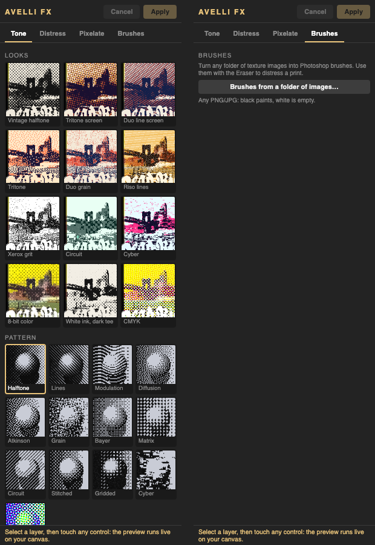
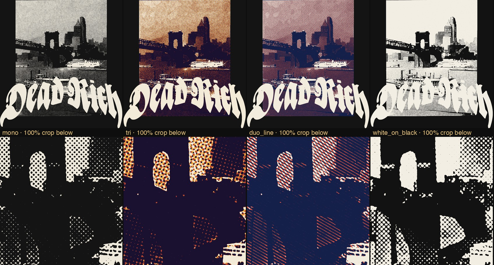
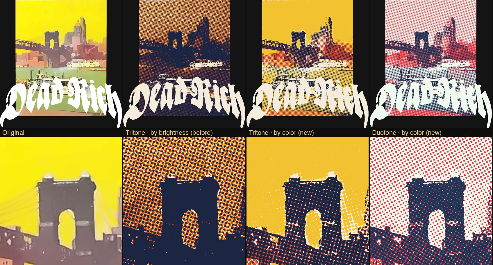

# Avelli FX

Print-style effects for Photoshop: real halftone screens, duotone and tritone separations, 13 dither patterns, distress, and pixelate. Everything previews live on your canvas.

## Download

Get **AvelliFX.ccx** from [Releases](../../releases/latest).

## Install

1. Double-click `AvelliFX.ccx`. Creative Cloud will install it. Plugins from outside the Adobe marketplace show a warning first; click Install.
2. Restart Photoshop.
3. Open **Plugins → Avelli FX**.

Needs Photoshop 2023 (v24.2) or newer.

## What it does

- **Tone:** halftone (round, ellipse, square or line dots), line screens, and 11 dither patterns (diffusion, Atkinson, grain, Bayer, matrix, modulation, circuit, stitched, gridded, cyber, CMYK).
- **Mono, duo or tritone inks**, separated by color like a real screen print, with each ink on its own screen angle.
- **Ink spread, roughness and cotton weave** for an organic, printed look.
- **Output** as inks only on transparent paper (ready for print), inks on paper, or the image's own colors. You can also split each ink onto its own layer.
- **12 one-click looks:** vintage halftone, tritone screen, duo line screen, riso lines, xerox grit and more.
- **Distress** (cracked paint, speckle, worn edges) as an editable layer mask.
- **Pixelate** with a color limit.
- **Brushes:** turn any folder of texture images into Photoshop brushes.
- **Live preview:** move a control and the layer updates on the canvas. Apply keeps it, Cancel reverts it, and Cmd/Ctrl+Z works.

## License

Free to download and use. All rights reserved: no redistribution, resale, or modified versions. See LICENSE.
